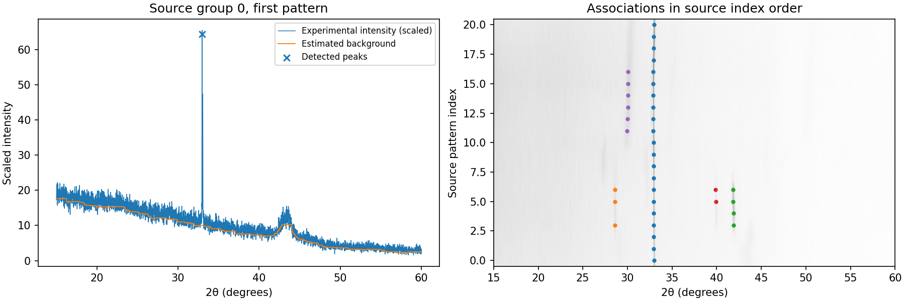

# Peak detection and tracking in noisy XRD scans

A Python pipeline for locating diffraction peaks and assigning consistent IDs across successive scans. Includes a public experimental opXRD subset and reproducible synthetic benchmarks with known peak centers and identities.

## Run

From this repository, using Python 3.10 or later:

```sh
python -m pip install -r requirements.txt
python -m unittest -v
python demo.py
```

The command creates `results/metrics.json` and, for each scenario, an example plot, an NPZ of simulated scans, and CSVs of ground-truth peaks and estimated tracks. `benchmark/` contains a checked-in run. To process an external scan, pass increasing, uniformly sampled 2θ angles and finite intensities to `detect(angles, intensities)`. Call `Tracker.update(frame, centers)` once per scan in frame order. The constants in `detect` are calibrated to the demo's angular sampling, peak widths and intensity scale.

## Public experimental dataset

The repository includes **342 experimental diffraction patterns** from the Heymans/Sutter-Fella contribution to opXRD v4, distributed under CC BY 4.0. They cover 16 source groups, each with a 15–60° angle range sampled at 0.01°. The approximately 10 MB subset includes original JSON records and a checksum manifest. [Dataset provenance and license](data/README.md)

Run the public-data demonstration offline with the same installed dependencies.

```sh
python public_data.py
```

The command saves detection CSVs, a summary JSON and an experimental plot in `results/public/`. The checked-in run in `benchmark-public/` processed all 342 patterns, producing **850 detected peak observations in 3.58 seconds** of detection and tracking time on the local machine. Loading, intensity scaling, scoring and plotting are excluded from that timing. There is no accuracy scoring for this subset.



Processing scales intensities consistently within each source group, uses the existing detector and resets the tracker between groups. Numeric source indices determine within-group ordering. Acquisition times and temporal continuity are unverified, and the source lacks hand-labeled peak centers and track IDs. The associations are exploratory, and detection/identity accuracy remains unevaluated. The fixed threshold misses weaker features visible in the plot.

Rebuild the subset with `python public_data.py --download`, which downloads the pinned 373 MB source archive and verifies its published checksum. The complete selection rule, source attribution, preprocessing and limits are documented alongside the data. [Original dataset](https://doi.org/10.5281/zenodo.14279434)

## Pipeline algorithms

1. **Smooth and estimate background.** An 11-sample, degree-three Savitzky–Golay filter fits a local polynomial. Grayscale opening takes a running minimum followed by a running maximum over a window about 1.1° wide. This suppresses positive features narrower than the window to estimate a slowly varying background. Broad peaks and scan boundaries can bias this estimate.
2. **Find candidates and refine centers.** SciPy finds local maxima in the smoothed, background-subtracted signal and filters by prominence and spacing. Within ±0.19° of each candidate, bounded least squares fits the unsmoothed, background-subtracted intensities. The pseudo-Voigt is a weighted sum of Gaussian and Lorentzian profiles that share a center and full width at half maximum. The local fit estimates four parameters: height, center, width, and mixture fraction. A fit that reaches its evaluation limit falls back to the candidate location.
3. **Associate across scans.** The assignment matrix uses absolute angular distances. A high cost for pairs beyond 0.12° makes the solver maximize feasible matches before minimizing total distance. Unmatched detections start IDs, and an ID can bridge up to two missing frames. SciPy solves the same linear assignment problem commonly taught with the Hungarian algorithm using its modified Jonker–Volgenant implementation.

## Benchmark protocol

An expanded run uses fresh seeds 100–109, totaling 1,600 simulated scans across 20 sequences. Reproduce it with `python demo.py --start-seed 100 --sequences 10 --out benchmark-expanded`. The detector settings are the same as the original run. This expands random noise realizations within the same generator.

| Scenario | Scans | Precision | Recall | Center MAE | Dominant-ID coverage | Pipeline time |
|---|---:|---:|---:|---:|---:|---:|
| Nominal | 800 | 100% | 100% | 0.00857° | 100% | 3.64 s |
| Crossing peaks | 800 | 99.93% | 92.24% | 0.01097° | 81.53% | 4.56 s |

Measured on the local Windows machine with Python 3.10.6 and the pinned dependencies. Runtime varies by machine and load. Full metrics and one example sequence per scenario are in `benchmark-expanded/`. Every sequence can be regenerated from its seed.

Seeds 21–25 generate 80 scans each per scenario, with 651 points per scan, a curved background, additive Gaussian noise, asymmetric peaks, drift and peak appearance/disappearance. The overlap case adds a crossing peak and higher noise. The same thresholds are used in both cases. The generator and detector were developed together. These runs characterize this simulation and do not estimate field accuracy.

Precision and recall use one-to-one matching within 0.08° per scan. Center MAE uses only matched peaks. Dominant-ID coverage counts, for each true peak in each sequence, how many observations matched its most frequently assigned ID, divided by all true observations. This penalizes gaps and fragmentation and can miss identity merges. Runtime includes detection and tracking and excludes generation, scoring, and plotting.

A single-peak fit cannot reliably separate a merged maximum. A position-only tracker can swap IDs when tracks cross. Phase identification would require interpreting multiple reflections and comparing them with reference patterns under the relevant instrument and material conditions.

[Peak finding](https://docs.scipy.org/doc/scipy/reference/generated/scipy.signal.find_peaks.html) · [Linear assignment](https://docs.scipy.org/doc/scipy/reference/generated/scipy.optimize.linear_sum_assignment.html)

